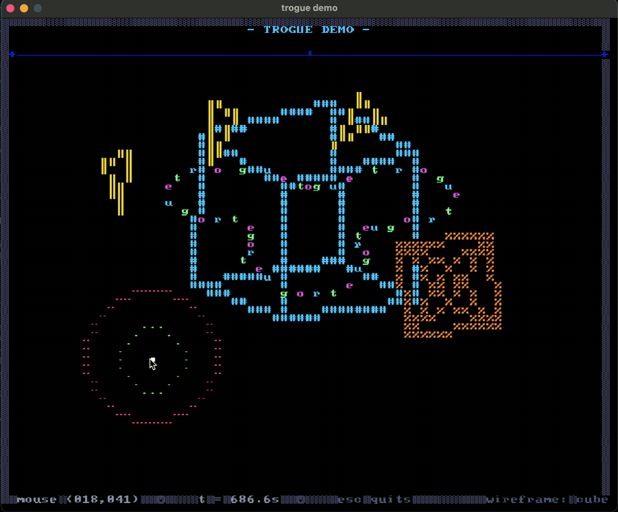

# trogue

<p align="center"></p>

<p align="center"></p>

An old project from 2020 that I keep public as a demo/portfolio piece. It pins libraries that nobody maintains anymore: `tetra` 0.4, the `sdl2` crate 0.34, `itertools` 0.9, `rand` 0.7. It still compiles with modern Rust, but expect friction, and don't expect fixes.

trogue is a graphics-agnostic API for building UIs that look like a terminal. You draw into a `Buffer` of `ConsoleCell`s (each one holds a glyph plus fg/bg color), using shapes and components. Rendering happens in a backend, and today there is exactly one: Tetra, drawing a CP437-style bitmap font texture.

## Features

- `Buffer` of `ConsoleCell`s: glyph + foreground/background color
- Shapes: `Rect`, `Line`, `Circle`, `Triangle`, `Curve`, drawn via `ShapeDrawable`
- Components: `TextComponent`, `DividerComponent`, drawn via `ComponentDrawable`
- `flood_fill`
- `TrogueApp`: manages buffers + mouse position
- `TetraBackend`: renders a `Buffer` with a bitmap font texture (8px glyphs, 16x16 CP437-style grid) plus TTF text via Tetra

## Quickstart

```toml
[dependencies]
trogue = "0.1.0"
```

Minimal usage. You own the Tetra `State`; trogue owns the buffer:

```rust
use tetra::graphics::{Color, Texture};
use trogue::backend::TetraBackend;
use trogue::shape::Line;
use trogue::trogue_app::TrogueApp;

struct App {
    app: TrogueApp,
    backend: TetraBackend,
}

impl App {
    fn new(ctx: &mut tetra::Context) -> tetra::Result<App> {
        Ok(App {
            app: TrogueApp::new(75, 75),
            backend: TetraBackend::new(Texture::new(ctx, "./examples/resources/terminal.png")?),
        })
    }
}

impl tetra::State for App {
    fn update(&mut self, ctx: &mut tetra::Context) -> tetra::Result {
        self.app.set_mouse_pos(10, 5);
        let buf = self.app.buf();
        buf.set_char(10, 5, 'H', Color::WHITE);
        buf.g_draw(Line::new(0, 0, 40, 10), '#', Color::WHITE);
        // buf.c_draw(my_component);
        Ok(())
    }

    fn draw(&mut self, ctx: &mut tetra::Context) -> tetra::Result {
        self.backend.draw(self.app.clone().draw(), ctx);
        Ok(())
    }
}
```

## Examples

```sh
# minimal demo
cargo run --example tetra

# full showcase: wireframe cube/octahedron, orbiting triangles, letter particles, HUD
cargo run --example demo
```

Press **Tab** to switch scenes. Pass `title` to start on the block-art TROGUE title scene:

```sh
cargo run --example demo -- title
```

## SDL version note

SDL2 only, tested with the official SDL2 2.32.x framework. `sdl2-compat` and SDL3 do not work: the `sdl2` crate panics on event types it doesn't know. That's the price of the 2020 dependency pins. Depending on your platform you may also need a local SDL2 install and some linker flags.

## Known gaps

- `Curve` is an empty stub
- No background support yet
- One backend only
